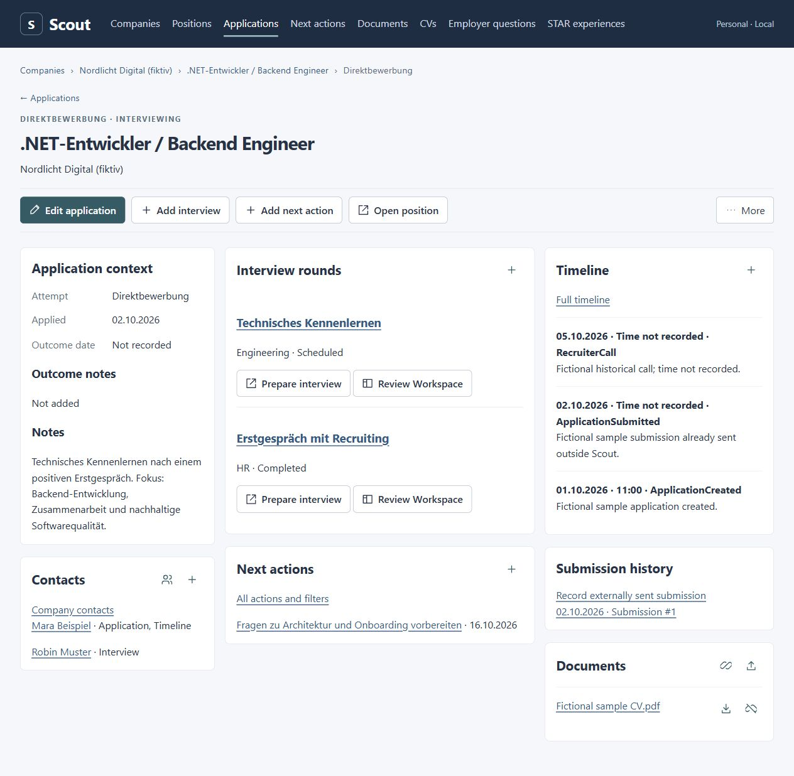
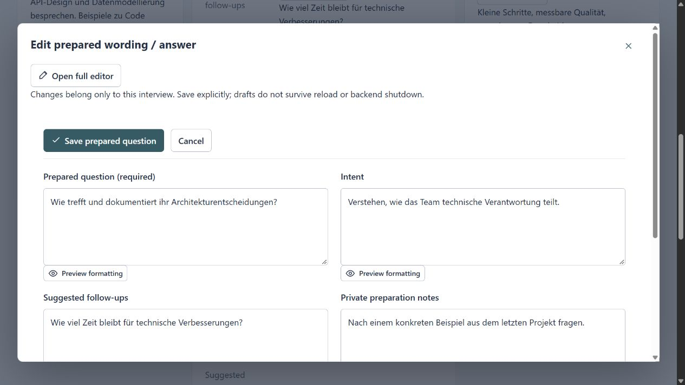
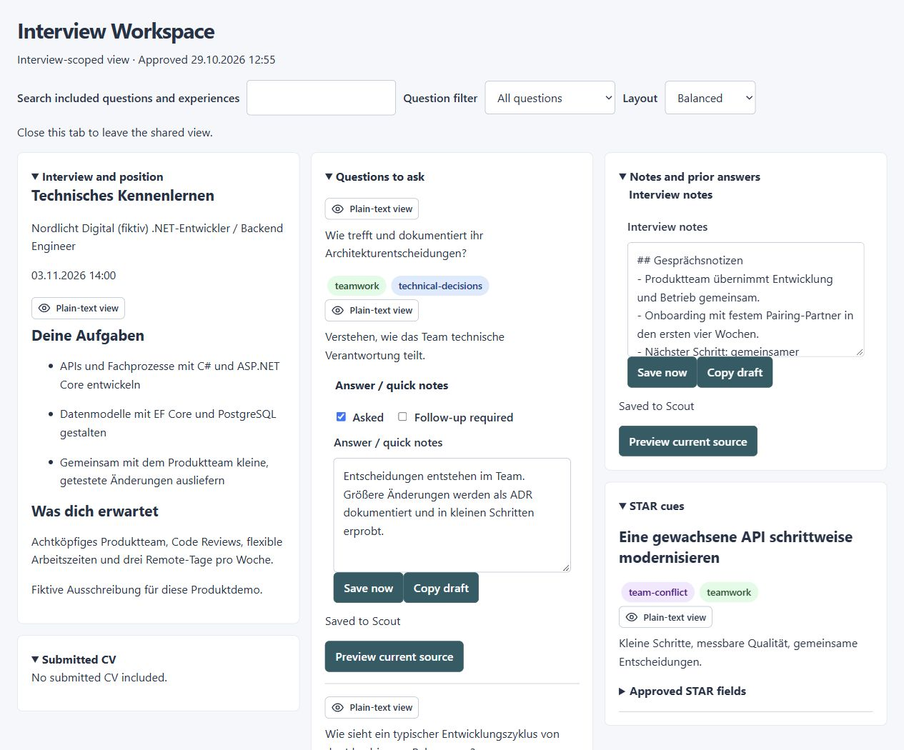

# Scout

> [!WARNING]
> **Scout is a pure vibe-coding experiment with OpenAI Codex.**
>
> No line of code is written by hand: 100% of the source code is generated by AI through Codex. I am explicitly building Scout as an experiment to explore how far vibe coding can go.

Scout is a personal job application and interview manager for Windows 11. It brings employers, positions, application history, documents and interview preparation into one local application.

Scout runs on your computer, stores its data locally and supports one user. Core workflows work without AI or external services. It does not send applications or messages on your behalf.

## What you can do

Screenshots use fictional companies, people and interview content.

**Keep an application in context** — interviews, contacts, next actions, documents and timeline in one view.



**Prepare your interview questions** — edit wording, intent, follow-ups and private preparation notes.



**Use the Interview Workspace during a call** — keep approved job details, questions, live answers, notes and STAR cues side by side.



- Track companies, positions, applications, contacts, timelines and next actions.
- Keep documents, prepared CV versions and records of the exact files submitted externally.
- Prepare interviews with reusable employer questions and STAR experience examples.
- Use a separate Interview Workspace with explicitly reviewed content, live answers and notes, autosave and browser draft recovery.
- Preserve interview history and continue with notes alone, without recordings or AI.
- Register external recordings with consent acknowledgments, play saved audio privately, and review imported transcripts or immutable corrected copies with simple Markdown.

For planned capabilities and implementation progress, see the [roadmap](docs/ROADMAP.md) and [milestone records](docs/README.md#milestone-plans-and-delivery-records).

Scout.Web milestones 1–6 are implemented. The [Web 1.0 baseline](docs/cycles/scout-web-v1/RELEASE_SUMMARY.md) records the desktop redesign, checks and remaining physical-display acceptance. The independent [Scout.Scribe v1 cycle](docs/cycles/scout-scribe-v1/README.md) has an implemented recording experiment and tray/settings, with remaining M1 acceptance pending; transcription and fact extraction/review are planned for M2–M3. The independent [Scribe.js Electron experiment](src/Scribe.js/README.md) compares another recording implementation. Neither is a Web release dependency. Rough future ideas live in the [feature wishlist](docs/FEATURE_WISHLIST.md).

## Quick start

On Windows 11, install .NET SDK **10.0.402**, or a later patch in the same SDK feature band as allowed by [global.json](global.json). From the repository root:

```powershell
dotnet tool restore
dotnet restore Scout.slnx
dotnet run --project src/Scout.Web --no-restore
```

Open [localhost:5180](http://localhost:5180). Keep one Scout process running while using the application. Stop it with **Ctrl+C**.

Initial restore requires NuGet access. Normal use runs through the local server and browser. Startup creates the storage directories and applies committed database migrations.

For alternate ports, reconnecting and troubleshooting, see [operations](docs/products/scout-web/OPERATIONS.md).

## Your data

Scout stores its SQLite database and imported files under `<user home>\Documents\Scout`, independently of the repository location. Development and ordinary runs use the same data root.

Before upgrading, stop Scout and back up the **entire data root**, including database sidecars, assets and retained failed imports. Follow the [backup and restore instructions](docs/products/scout-web/OPERATIONS.md#backup-upgrade-and-restore) when restoring; do not replace only the database.

Workspace browser drafts are separate from database saves. They depend on the browser's local storage and are not included in a data-root backup. General management forms require manual saving. See the [user guide](docs/products/scout-web/USER_GUIDE.md) for saving, conflicts and draft recovery.

Scout listens on localhost. It has no login or at-rest encryption; software running under your account can access its stored data.

## Documentation

| I want to… | Read |
|---|---|
| Manage applications, documents and interviews | [User guide](docs/products/scout-web/USER_GUIDE.md) |
| Back up, restore or troubleshoot Scout | [Operations](docs/products/scout-web/OPERATIONS.md) |
| Build, test or change the application | [Development guide](docs/engineering/DEVELOPMENT.md) |
| Understand requirements and the domain | [Documentation overview](docs/README.md) |
| Review planned work and delivery evidence | [Roadmap](docs/ROADMAP.md) and [milestone records](docs/README.md#milestone-plans-and-delivery-records) |

Scout.Web uses ASP.NET Core, Blazor Interactive Server, Entity Framework Core and SQLite, without a separate frontend build. The .NET solution also contains Scout.Scribe and its tests; the Scribe.js Electron experiment has its own npm build outside that solution.
