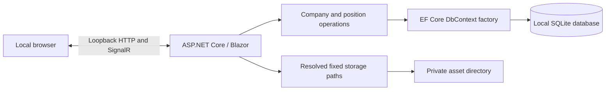

# Scout: Milestone 1 architecture

Status: implemented through M1.6 with a fixed storage root; verification recorded in the delivery plan and README.
Reviewed: 15 October 2026.  
Specification: [SCOUT_SPEC.md](SCOUT_SPEC.md).  
Delivery plan: [MILESTONE_1_PLAN.md](MILESTONE_1_PLAN.md).

## 1. Recommendation and repository findings

Build one ASP.NET Core Blazor Web App using Interactive Server rendering, EF Core, and SQLite. Keep the UI, feature operations, entities, and persistence in one application project, with one separate test project. Use ordinary C# classes, built-in forms and validation, and local CSS.

At the initial inspection, the repository contained only `docs/SCOUT_SPEC.md`; the two planning documents have since been added. No application, solution, package configuration, or applicable `AGENTS.md` was found. Version control was initialized separately while M1.1 implementation was in progress.

After the user's SDK update, `dotnet --version` reports **10.0.402**. The installed ASP.NET Core and .NET runtimes include **10.0.13**. No SDK installation is outstanding.

There are **no architectural contradictions or unanswered questions that block Milestone 1**. The implementation choices below were approved by the user; they refine rather than replace the specification. The user subsequently permitted a hardcoded storage root at `<user home>\Documents\Scout`, superseding the earlier configurable root proposal for Milestone 1.

## 2. Specification reconciliation

| Specification tension | Proposed interpretation |
| --- | --- |
| Sections 4 and 9 describe the whole MVP; section 10 defines a much smaller Milestone 1. | Section 10 sets this implementation boundary. Search, archive, and pasted vacancy text make company/position management useful; applications, contacts, files, and interviews wait. |
| “CRUD” versus preservation and archiving requirements in sections 8 and 13. | Create, read, update, archive, and restore. No permanent-delete UI or cascading record deletion in Milestone 1. |
| Position status includes “archived”; preservation also calls for archived records. | Keep opportunity status and archival visibility separate: four opportunity statuses plus `IsArchived`. Restoring preserves the prior opportunity status. |
| A description is a preserved snapshot, but positions are editable. | Preserve the first nonempty pasted description as an original snapshot. Other position fields and personal notes remain editable. See the explicit tradeoff below. |
| Several UI technologies are acceptable in section 2. | Select Blazor Interactive Server as requested. Use one UI approach throughout Milestone 1. |
| General configuration includes storage and optional recording/transcription/AI settings. | Per the user's subsequent instruction, use a fixed Documents/Scout root in M1. Add other settings when their capabilities are implemented; no empty provider infrastructure. |
| The Workspace describes “Start recording,” while the MVP uses an external recorder. | This does not block Milestone 1. Later, show recorder controls only when a real integration exists; an external workflow must not claim Scout started recording. |
| Local-only and no authentication, alongside privacy requirements. | Bind to loopback, retain normal browser protections, and keep data outside static assets. The ordinary UI is private; a screen-shareable Workspace is a separate later requirement. |

## 3. Proposed repository structure

Create these files and directories incrementally when their slice needs them:

```text
Scout/
  Scout.slnx
  global.json
  .config/dotnet-tools.json
  .editorconfig
  .gitignore
  README.md
  docs/
    SCOUT_SPEC.md
    MILESTONE_1_ARCHITECTURE.md
    MILESTONE_1_PLAN.md
  src/
    Scout.Web/
      Scout.Web.csproj
      Program.cs
      appsettings.json
      appsettings.Development.json
      Properties/launchSettings.json
      Configuration/
        StoragePaths.cs
      Components/
        App.razor
        Routes.razor
        _Imports.razor
        Layout/
        Pages/
          Companies/
          Positions/
      Features/
        Companies/
          CompanyOperations.cs
          CompanyEditModel.cs
        Positions/
          PositionOperations.cs
          PositionEditModel.cs
      Domain/
        Company.cs
        Position.cs
        PositionStatus.cs
      Data/
        ScoutDbContext.cs
        DevelopmentSamples.cs
        Migrations/
      wwwroot/
        app.css
  tests/
    Scout.Web.Tests/
      Scout.Web.Tests.csproj
      Companies/
      Positions/
      Data/
      Configuration/
```

`Scout.Web.Tests` references `Scout.Web`. EF mappings can start in `ScoutDbContext.OnModelCreating`; separate mapping files are only needed if it becomes hard to read. Small list/detail projection records can stay with their feature operations.

Do not add separate Domain/Application/Infrastructure assemblies, a Web API project, client WebAssembly project, generic repositories, a unit-of-work wrapper, MediatR, AutoMapper, plugin interfaces, background workers, or a frontend build system. EF Core supplies persistence and transactions directly. No placeholder folders, tables, or services for later milestones.

## 4. Runtime and data flow



The asset directory is resolved and created in this milestone; it has no import or HTTP file-serving capability yet.

### UI and feature operations

- Use the standard Blazor Web App template with server interactivity and no authentication. Apply Interactive Server to `Routes` and `HeadOutlet`, with prerendering disabled initially to avoid duplicate initialization work. Browser testing found that page-level interactivity allowed enhanced navigation to bypass the unsaved-form navigation guard; an interactive router keeps navigation within the circuit so `NavigationLock` can intercept it. Pages inherit the router's render mode.
- Razor components handle display, edit state, validation messages, and navigation. Concrete `CompanyOperations` and `PositionOperations` classes handle queries, validation of relationships, and saves. Do not introduce an interface for each class.
- Use `EditForm`, built-in input components, Data Annotations, and explicit feature checks for rules such as selecting an existing company. Validate again at the feature-operation boundary so tests and later callers receive the same rules.
- Register `AddDbContextFactory<ScoutDbContext>`. Create and dispose a context for each load or save. Never hold a tracked entity or `DbContext` for a whole Blazor circuit. This follows [Microsoft's Blazor EF Core guidance](https://learn.microsoft.com/en-us/aspnet/core/blazor/blazor-ef-core?view=aspnetcore-10.0).
- Use no-tracking projections for reads, and load the target entity in a fresh context for a write. Copy only allowed form fields. UI models do not allow the client to set IDs or audit timestamps.
- Use one `SaveChangesAsync` per ordinary edit; its normal transaction is sufficient. Disable repeated submission while saving and show success only after the commit.
- Keep unsaved form content visible after a recoverable validation or database error. Provide explicit Save and Cancel, an unsaved-navigation warning, useful not-found pages, and a retryable error message. Browser draft recovery/autosave belongs to the later interview-notes requirement.
- Milestone 1 uses last successful save wins for simultaneous edits in different tabs. There is no collaboration or audit history. Document this limit; do not add concurrency-token infrastructure for simple single-user CRUD.

### Pages and navigation

| Route | Purpose |
| --- | --- |
| `/` | Redirect to companies; no dashboard yet. |
| `/companies` | Company list, search, archive filter, create action. |
| `/companies/new` | Minimal company creation. |
| `/companies/{id:int}` | Company details, related positions, edit/archive/restore actions. |
| `/companies/{id:int}/edit` | Company editing. |
| `/positions` | Position list, search, company/status/archive filters. |
| `/positions/new` | Position creation; an optional company query parameter preselects the company. |
| `/positions/{id:int}` | Position details and preserved vacancy text. |
| `/positions/{id:int}/edit` | Edit position fields and add the initial description if absent. |

Use the same form component within each feature for create/edit where useful. Navigation contains Companies and Positions only. Use readable labels, visible focus, keyboard-accessible controls, a comfortable desktop content width, and simple local CSS. No third-party component library or CDN assets are needed. English interface text and German/English user content are sufficient; a localization framework is unnecessary now.

M1.2 shares a single `Editor.razor` page between the two company form routes. It loads a detached edit model, preserves the draft after validation/database errors, and navigates to details only after a successful save. A small HTTP/HTTPS validation attribute is shared by Data Annotations in the form and the feature operations. The additive `CompanyDetails` migration introduces four nullable text columns and preserves existing company records. No new packages are needed.

M1.3–M1.6 follow the same approach for positions, with one additive `Positions` migration. Shared code is limited to the URL validator, archive enum/control, and catalog query-link helpers used by both features. Catalog search uses ordinary GET forms and query parameters, with a query-only return value carried through detail/edit links. Invalid enum filters fall back to their default view. `DevelopmentSamples` runs after migration at application startup, behind the environment/opt-in/empty-table guards; its explicit transaction covers the emptiness check and one save. No additional dependencies or business tables were introduced.

## 5. Milestone 1 relational model

Only two business tables are needed: `Companies` and `Positions`, plus EF migration history. Use integer primary keys and an explicit required `Position.CompanyId` foreign key, indexed, with restricted deletion. A company may have zero or many positions; a position must have one company. Names and vacancy URLs are not unique: duplicates can be legitimate and deduplication is not part of this milestone.

| Company field | Rule |
| --- | --- |
| `Id` | Generated integer key. |
| `Name` | Required, trimmed, 1–200 characters. The only user-entered required company field. |
| `WebsiteUrl` | Optional absolute HTTP/HTTPS URL, at most 2,048 characters. |
| `Description` | Optional factual/reference description, plain text. |
| `Location` | Optional free text for headquarters/locations, at most 300 characters. |
| `PersonalNotes` | Optional impressions, assessments, and other personal notes, separate from description. |
| `IsArchived` | False by default. |
| `CreatedAtUtc`, `UpdatedAtUtc` | Set by the application; creation timestamp remains unchanged. |

| Position field | Rule |
| --- | --- |
| `Id`, `CompanyId` | Generated key and required existing-company FK. |
| `Title` | Required, trimmed, 1–200 characters. |
| `OriginalVacancyUrl` | Optional absolute HTTP/HTTPS URL, at most 2,048 characters; never fetched automatically. |
| `JobDescriptionSnapshot` | Optional pasted plain text; retain line breaks and original wording. |
| `DescriptionCapturedAtUtc` | Set with the first nonempty snapshot; otherwise null. |
| `Location` | Optional free text, at most 300 characters. |
| `RemoteWorkNotes`, `EmploymentType` | Optional plain-text requirements/type; employment type at most 100 characters. |
| `PersonalNotes` | Optional personal assessment and notes. |
| `Status` | `Discovered` (default), `Interested`, `RejectedByUser`, `Expired`; store stable string values. |
| `DiscoveredOn` | `DateOnly`, default to the user's local current date; editable for historical entry. |
| `ClosingOn` | Optional `DateOnly`; historical vacancies are allowed. |
| `IsArchived` | False by default, independent of status. |
| `CreatedAtUtc`, `UpdatedAtUtc` | Application-controlled audit timestamps. |

Required position inputs are company and title; defaults supply status and discovery date. Unknown optional values remain null/empty rather than invented facts. Set a generous explicit 100,000-character limit on long-text fields and enforce it in forms and feature operations; SQLite column length metadata alone does not enforce that policy.

Use UTC `DateTime` for audit/capture timestamps and restore UTC semantics when reading persisted values; show them in local time. Date-only fields carry no offset. SQLite's limitations favor this over ordering `DateTimeOffset` values; see [EF Core SQLite limitations](https://learn.microsoft.com/en-us/ef/core/providers/sqlite/limitations). Structured salaries, publication dates, taxonomy tables, technologies, multiple structured locations, and verified-fact provenance are deferred. Information can be retained in descriptions/notes until structured workflows justify those fields.

### Vacancy preservation decision

The first nonempty saved description becomes read-only, including through the feature operation. An empty description can be filled later. Editing title, URL, status, company, or notes never changes it. Corrections and subsequent changes can be noted in `PersonalNotes`. This is a conservative, small implementation of preservation; it deliberately sacrifices direct snapshot correction. If review favors editable corrections, agree how the original will remain preserved before changing this rule. Do not implement a document/version subsystem in Milestone 1.

### Archive decision

- Archiving or restoring a company changes that company's flag only. Positions remain associated and retain their own flags and statuses.
- The default company list excludes archived companies. The default position list excludes archived positions, but still shows an active position whose company was archived, with an “Archived company” badge. This prevents company archiving from silently removing opportunities.
- A company detail page remains reachable by ID and shows related positions with their archive state. Explain that company archiving does not archive positions.
- New positions must select an active company. Existing positions under archived companies remain readable/editable; changing their company requires an active target. Restore a company to create more positions under it.
- Each catalog provides Active / Archived / All filters referring to that entity's own flag. Restore a position without changing its status. No global EF query filters: use explicit predicates so details and restoration remain straightforward.

### Search and sorting

Company search covers name and location. Position search covers title, company name, and location; filter additionally by company and opportunity status. This is catalog search, not full-text search of notes/descriptions.

For the small personal dataset, first apply structured filters in SQLite and project only list fields, then perform case-insensitive substring matching in .NET using `OrdinalIgnoreCase`. Sort companies by name and ID; positions by most recently discovered date, then title and ID. This handles `MÜNCHEN`/`münchen` without assuming SQLite `LIKE` provides Unicode case folding. Accent removal or `ß`/`ss` equivalence is not promised. See [Microsoft.Data.Sqlite collation guidance](https://learn.microsoft.com/en-us/dotnet/standard/data/sqlite/collation). No search engine or custom collation is necessary. Revisit database-side search/pagination only if actual data volume warrants it.

## 6. Local execution, storage, and preservation

### Listener and browser boundary

Use one loopback-only Kestrel listener, normally `http://localhost:5180`, with a configurable port. Enforce loopback binding in application setup rather than relying solely on a launch profile; arbitrary URL environment overrides must not expose Scout on the LAN. A port conflict should fail clearly rather than switching to a wildcard listener. Kestrel supports binding to both loopback address families through localhost; see [endpoint documentation](https://learn.microsoft.com/en-us/aspnet/core/fundamentals/servers/kestrel/endpoints?view=aspnetcore-10.0).

HTTP on loopback is sufficient for this milestone; no certificate setup or authentication screen is required. Restrict accepted hosts to the local names/addresses actually used, retain antiforgery protections, and restrict browser-origin access to interactive endpoints, including WebSocket handshakes. Do not assume CORS alone restricts WebSockets; see [Blazor cross-origin guidance](https://learn.microsoft.com/en-us/aspnet/core/blazor/security/interactive-server-side-rendering?view=aspnetcore-10.0). Keep these checks in the ordinary host setup, without introducing a security subsystem.

Display user-entered descriptions and notes as encoded text, never raw HTML. Allow only HTTP/HTTPS external links, open them only on deliberate user activation, and do not fetch remote previews or favicons. All UI resources are local. The app needs no network access beyond loopback to operate after dependencies have been restored. Local-only is not isolation from other software running under the Windows account; no at-rest encryption is proposed in Milestone 1.

### Fixed storage root

The user approved hardcoding `<user home>\Documents\Scout` as the root for SQLite and all managed files/documents. Resolve the user home with `Environment.GetFolderPath(Environment.SpecialFolder.UserProfile)` and append `Documents` and `Scout` using `Path.Combine`. `%USERHOME%` expresses the user's intent here; do not depend on an environment variable with that name or hardcode the account name. On the current machine this resolves to `C:\Users\Max\Documents\Scout`.

| Location / option | Fixed value / interpretation |
| --- | --- |
| Data root | `<user home>\Documents\Scout` in both Development and ordinary runs. |
| SQLite database | `<root>\database\scout.db`. |
| Managed assets | `<root>\assets`; future documents/files remain beneath this root. |
| `Development:SeedSampleData` | False by default; effective only in Development. |

Resolve and validate these paths once at startup, independently of the shell's working directory, and keep them outside `wwwroot`. Display resolved paths in startup diagnostics without logging record contents. Create only the required directories; report an unavailable user home or inaccessible paths clearly and stop on initialization failure. Do not add user-facing storage configuration or a storage settings screen for M1. Automated tests supply an isolated temporary root directly to the path/persistence setup and never use the real Documents directory.

Do not move existing data automatically, silently fall back to another database, delete files, mount asset folders as static files, or create the proposed audio/transcript/import/export tree yet. There is no upload endpoint, file picker, external recorder integration, or file-storage interface in this milestone. Development and ordinary runs share this root, so development mode alone must never insert samples: the explicit opt-in and empty-database rules remain mandatory.

### Migrations, samples, and backup

- Commit normal EF migrations alongside the application. Use `MigrateAsync` before accepting requests, never `EnsureCreated` in the app or migration tests. Automatic startup migration is appropriate for one local app process; review each migration for destructive operations before using personal data.
- Use the same fixed storage resolution for application startup and EF design-time commands. Keep migration execution separate from sample insertion; EF commands must not seed personal databases as a side effect.
- Do not reset or recreate a database when a migration fails. Report the failure and stop. Run one Scout process per database; stop it before manual migration/backup operations. SQLite migration-lock troubleshooting is a manual maintenance concern, never an automatic “delete lock/reset database” action.
- The opt-in development seeder inserts a tiny fixed fictional dataset in one transaction only when both business tables are empty. Never update existing samples, reseed a nonempty database, or seed outside Development. Use `.example` URLs and no real opportunities or personal information.
- Document a manual backup: stop Scout and copy the whole `Documents\Scout` root, including any SQLite sidecar files. Restart afterward. Restore while stopped and keep the old data as a separate copy. No backup scheduler or cleanup job.
- Future `.gitignore` entries exclude local data, SQLite databases/sidecars, logs, build output, and local override files. No database files or user assets belong in source control.

## 7. Stable dependency baseline

Verified against official release/package pages on **15 October 2026** and restored during M1.1. These are the implementation pins; the remaining slices use the same baseline.

| Dependency | Proposed version | Use / primary source |
| --- | --- | --- |
| .NET SDK | **10.0.402** | Pin in `global.json`, allow later patches in the same feature band. Installed and active. [Official download](https://dotnet.microsoft.com/en-us/download/dotnet/10.0). |
| .NET / ASP.NET Core / Blazor | **10.0.13**, target `net10.0` | Shared framework supplied by the SDK/runtime, not separate Blazor NuGet packages. [Official release](https://dotnet.microsoft.com/en-us/download/dotnet/10.0). |
| C# | **14** | Default language for `net10.0`; no preview setting. [Official .NET overview](https://dotnet.microsoft.com/en-us/download). |
| `Microsoft.EntityFrameworkCore.Sqlite` | **10.0.13** | Main persistence dependency. [Package](https://www.nuget.org/packages/Microsoft.EntityFrameworkCore.Sqlite/10.0.13). |
| `Microsoft.EntityFrameworkCore.Design` | **10.0.13** | Migration tooling; `PrivateAssets=all`. [Package](https://www.nuget.org/packages/Microsoft.EntityFrameworkCore.Design). |
| `dotnet-ef` | **10.0.13** | Repository-local tool manifest, not a global installation. [Tool](https://www.nuget.org/packages/dotnet-ef). |
| `xunit.v3` | **4.0.2** | Test project only; the package ID retains `v3` despite its current package version. Supplies Microsoft Testing Platform support transitively. [Package](https://www.nuget.org/packages/xunit.v3). |

.NET 10 is the current stable LTS line, supported through November 2028; .NET 11 is still a prerelease and is not proposed. See the [official support policy](https://dotnet.microsoft.com/en-us/platform/support/policy/dotnet-core). Some indexed pages still show September patches; the October release and exact EF provider page above establish the newer versions.

Keep EF runtime/design/tool packages at the same patch. Use the SQLite native dependencies supplied transitively by the EF SQLite provider; no separate SQLite executable or manually chosen engine package is needed. Pin direct NuGet versions in the two project files; central package management is unnecessary at this size. Recheck stable patch versions when implementation actually begins.

M1.1 verification found that the package's current Microsoft Testing Platform no longer supports the legacy VSTest entry point with .NET 10. Select `Microsoft.Testing.Platform` in `global.json` and run `dotnet test --solution Scout.slnx`; remove the unnecessary VSTest adapter and `Microsoft.NET.Test.Sdk` references. This follows [Microsoft's .NET 10 runner guidance](https://learn.microsoft.com/en-us/dotnet/core/testing/unit-testing-with-dotnet-test) and the xUnit [getting-started guide](https://xunit.net/docs/getting-started/v3/getting-started).

No test mocking library, coverage service, EF InMemory provider, bUnit, or Playwright package is required initially. `Microsoft.AspNetCore.Mvc.Testing` is available at [10.0.13](https://www.nuget.org/packages/Microsoft.AspNetCore.Mvc.Testing), but is not an initial dependency: feature tests use real SQLite, and the small interactive UI receives browser smoke checks. M1.1 browser acceptance passed on 15 October 2026, including company creation, validation, unsaved-form navigation, and persistence after restarting Scout.

## 8. Decisions intentionally left open

| Decision | Treatment |
| --- | --- |
| Exact suggested entity fields and requiredness | The minimal fields above are the proposed M1 choice. More structured industries, technologies, salary/currency, remote policies, and locations can be added by migration after use demonstrates a need. Notes retain information now. |
| Archive cascade and vacancy correction | The concrete defaults above are approved for M1. Neither requires a framework or extensibility mechanism. |
| Application multiplicity/status customization | Decide in M2 whether repeat applications per position are allowed and whether “easy to modify” means simple UI status changes or user-editable status definitions. Do not add application tables or configurable workflow machinery now. |
| Reusable attachment relationships and exact submitted CV preservation | Decide concrete relational joins and immutable storage behavior in M2. A generic `(EntityType, EntityId)` attachment system is not needed in M1. The source-preservation requirement is already fixed. |
| Interview presentation/privacy | The future Workspace needs its own scoped query models and layout. M1's layout is not a promise of screen-share safety. Do not build or prefetch interview data now. |
| File layout and backups | The fixed Documents/Scout root, database/asset subdirectories, and documented manual backup are sufficient now. Import naming, hashes, supported types, and backup automation wait for file workflows. |
| Recording, transcription, and AI providers | Provider/library choices, data-transfer authorization, and processing jobs wait for their milestone. Their independence and explicit user initiation are fixed constraints. |
| UI refinement and localization | Begin with ordinary pages, local CSS, English labels, and Unicode content. Refine based on actual desktop use; no drag/drop, theming system, or resource catalog now. |

There is no outstanding architectural clarification. The approved choices include independent archiving, a read-only original vacancy snapshot, startup migrations, a deliberately small field set, and the fixed Documents/Scout storage root.
